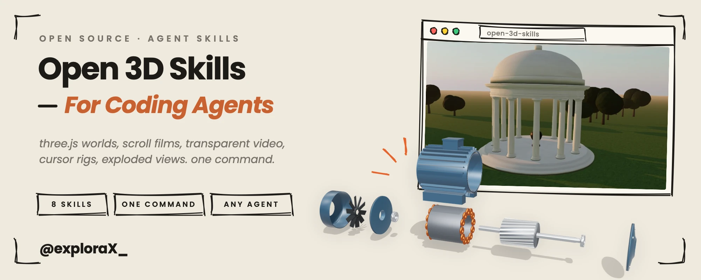
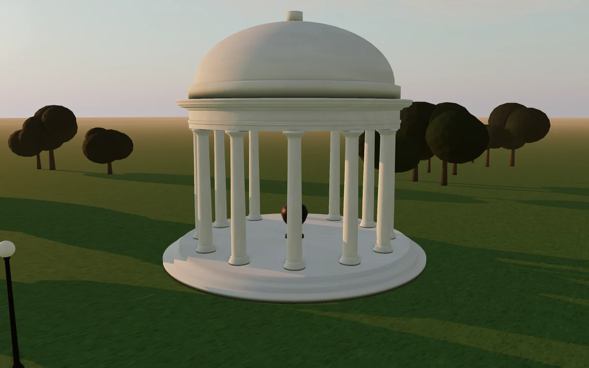
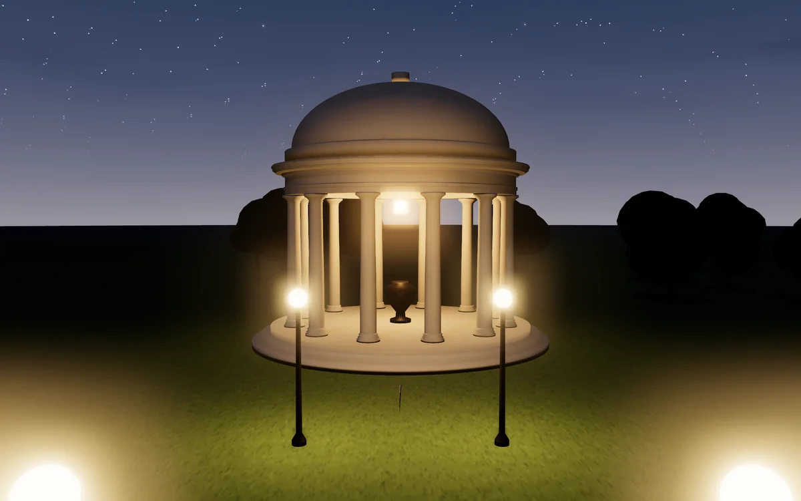
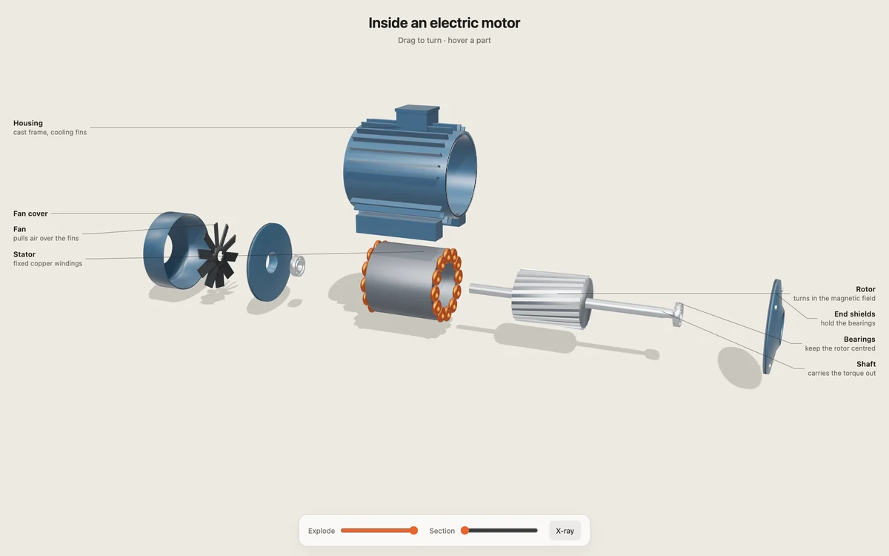

<p align="center">
  <picture>
    <source media="(prefers-color-scheme: dark)" srcset="assets/cover-dark.webp" />
    
  </picture>
</p>

<p align="center">
  <a href="LICENSE"></a>
  &nbsp;
  
  &nbsp;
  
  &nbsp;
  <a href="https://github.com/Moh4696/open-3d-skills/actions/workflows/check.yml"></a>
</p>

**Open 3D Skills** are eight agent skills for building 3D and animated websites: real-time three.js scenes built from code, scroll-scrubbed films, transparent video that plays in Safari, characters that follow the cursor, exploded views of machines, and the AI image and video work behind them. They also teach the agent to check its work in real browsers and to record it as a smooth 60 fps video.

Every technique here was used to build a real site first, and every script was run on real footage before it went in.

<p align="center">
  
</p>

<table>
  <tr>
    <td width="50%"></td>
    <td width="50%"></td>
  </tr>
  <tr>
    <td width="50%"></td>
    <td width="50%"></td>
  </tr>
</table>

<sub>The pavilion is the starter scene in <code>threejs-scene</code>; the motor is the demo in <code>exploded-view</code>. Both are built entirely from code: no model files, no textures to download.</sub>

## Install

```bash
npx skills add Moh4696/open-3d-skills
```

That installs with the [`npx skills`](https://github.com/vercel-labs/skills) CLI, the open installer for agent skills. It asks which of the eight skills you want, which agents to install them for (Claude Code, Codex, Cursor, Gemini CLI, OpenCode, Antigravity and dozens more) and whether they are for this project or every project. Start a new agent session afterwards.

```bash
npx skills add Moh4696/open-3d-skills -g -y                       # all skills, all your agents, every project, no questions
npx skills add Moh4696/open-3d-skills --skill threejs-scene       # just one skill
npx skills update                                                  # pull new versions later
```

`npx skills` needs Node 22.20 or newer.

<details>
<summary>Claude Code plugin</summary>

Inside Claude Code:

```
/plugin marketplace add Moh4696/open-3d-skills
/plugin install open-3d-skills@open-3d-skills
```

The skills are namespaced as `open-3d-skills:threejs-scene` and so on, so they never collide with other skills. `/plugin update` upgrades them.

</details>

<details>
<summary>Codex plugin</summary>

```bash
codex plugin marketplace add Moh4696/open-3d-skills
codex plugin add open-3d-skills@open-3d-skills
```

Start a new Codex session afterwards.

</details>

<details>
<summary>Cursor</summary>

The one-line installer links the skills into `~/.cursor/skills`, where Cursor finds personal skills. To use the repo as a Cursor plugin instead, clone it into `~/.cursor/plugins/local/open-3d-skills` and run **Developer: Reload Window**. Teams can import the repo URL as a marketplace under **Dashboard → Plugins & MCPs → Add Marketplace**.

</details>

<details>
<summary>Gemini CLI</summary>

```bash
gemini extensions install https://github.com/Moh4696/open-3d-skills
```

`gemini extensions update` pulls new versions.

</details>

<details>
<summary>Without Node: the shell installer</summary>

```bash
curl -fsSL https://raw.githubusercontent.com/Moh4696/open-3d-skills/main/install.sh | bash
```

It installs all eight skills for every coding agent it finds (Claude Code, Codex, Cursor, Gemini CLI, and OpenCode, which also reads Claude Code's folder). It clones the repo to `~/.open-3d-skills` and links the skills from there, so running it again updates them. From a clone you can choose:

```bash
git clone https://github.com/Moh4696/open-3d-skills && cd open-3d-skills
./install.sh --claude --codex          # only these agents (also --cursor --gemini --opencode --agents)
./install.sh --dir path/to/skills      # any agent that reads a skills folder
./install.sh threejs-scene frame-capture   # only some skills
./install.sh --copy                    # copy instead of symlink (Windows, synced folders)
./install.sh --uninstall               # remove what it installed
```

Each skill is a plain folder with a `SKILL.md`, so any agent that supports Agent Skills can load it.

</details>

## The skills

| Skill | What it does | Ships with |
| --- | --- | --- |
| [`threejs-scene`](skills/threejs-scene) | Real-time 3D sites built from code: buildings, vehicles, machines, landscapes. Sky and sun presets that blend, soft fitted shadows, ambient occlusion, bloom, instancing, profile sweeps, shader patches, camera flights, quality tiers | A complete 60 fps starter scene, and notes on lighting, geometry, shaders and performance |
| [`scroll-film`](skills/scroll-film) | Scroll-scrubbed films from generated clips: chained with start and end frames, holds for captions, phone versions, loading order, reduced motion | `scroll-film.js` engine, a prep script for frames or scrub-ready video, a seam checker |
| [`motion-assets`](skills/motion-assets) | Planning and generating AI images and clips without wasting money: asset lists with prompts and costs up front, one look across assets, model choice by capability, rate limits, logging | A loop checker that finds and fixes loop points, and a paste-back tool for outpainted images |
| [`alpha-cutout`](skills/alpha-cutout) | Transparent video from clips shot on a key plate: per-frame plate measurement, edge unmixing, outputs for every browser including Safari | Plate builder, keyer (stacked-alpha MP4, VP9 alpha, WebP frames), WebGL alpha video player |
| [`cursor-rig`](skills/cursor-rig) | A painted character whose head follows the cursor, built as a grid of poses on one fixed body, with live blinks | Rig builder (alignment, even steps, flow in-betweens) and a spring-driven canvas player |
| [`exploded-view`](skills/exploded-view) | Interactive explainers of how machines work: staged explode, x-ray, section cut, labels with leader lines, picking | `explode.js` and the motor demo above |
| [`site-check`](skills/site-check) | Checks a 3D or animated page in headless Chromium and WebKit at three sizes: frame time, draw calls, errors, blank canvases, overflow, reduced motion | A checker that writes a report and a contact sheet, and a Range-capable local server |
| [`frame-capture`](skills/frame-capture) | Frame-exact 60 fps video of any page by running it on a virtual clock; labelled side-by-side or stacked comparisons | Recorder, comparison builder, local server |

## How they work together

1. **Plan.** `motion-assets` writes the concept, the asset list, every prompt and the cost, and waits for a yes before spending anything.
2. **Make.** `threejs-scene` builds what should be real-time. `scroll-film`, `alpha-cutout` and `cursor-rig` turn generated clips into page motion. `exploded-view` takes a machine apart.
3. **Check.** `site-check` shoots every state in real browsers and fails on errors, blank canvases and broken phone layouts.
4. **Show it.** `frame-capture` records the result as a smooth video for X, YouTube or a client, and builds before-and-after comparisons.

## Requirements

The skills are instructions; their scripts need:

- **Node 22.20+** for `npx skills` and the repo's own checks. The browser code has no build step.
- **Python 3.9+** with `pip install -r requirements.txt` (Playwright, Pillow, NumPy, OpenCV), then `python3 -m playwright install chromium webkit`.
- **ffmpeg** on your PATH.
- An image and video generation service (any) for `motion-assets`, `alpha-cutout`, `cursor-rig` and `scroll-film`. `threejs-scene`, `exploded-view`, `site-check` and `frame-capture` need none.

Nothing is installed behind your back and no API keys are stored by the skills.

## Common questions

**Do I need a particular AI video service?**
No. The skills describe what a model must be able to do (start and end frames, image editing that holds framing) and how to check its output. They were built with Higgsfield, MiniMax, Kling, Seedance and Nano Banana, and say so where a behaviour was observed.

**Why build 3D from code instead of loading models?**
Code-built scenes are small, sharp at any size, free of licensing questions and easy for an agent to change. `exploded-view` works on loaded GLB files too.

**Does it work with React, Vue or Svelte?**
Yes. The modules are plain ES modules and the techniques are framework-free.

**Can I install just one skill?**
Yes: `npx skills add Moh4696/open-3d-skills --skill scroll-film`. Skills mention each other by name where they work together, but each one works alone.

## Works well with

- [Cinematic Skill](https://github.com/Moh4696/cinematic-skill), from the same author: narrated cinematic films built entirely from code, with one continuous camera over photos, maps and cards, timed to the voice. It uses `motion-assets` from this repo when a film needs AI stills.
- [Taste Skill](https://github.com/Leonxlnx/taste-skill) by Leonxlnx: art direction for the page around your 3D. It also inspired the layout of this repo.
- [scroll-world](https://github.com/oso95/scroll-world) by oso95: Higgsfield fly-through worlds.
- [Anatomy](https://github.com/wheresryan22/anatomy) by wheresryan22: isometric SVG explainer figures.
- [Interfaces skills](https://github.com/jakubkrehel/skills) by Jakub Krehel: typography, layout, colour, accessibility and UI polish.

## Feedback

Open an issue or a pull request, or find me on X at [@exploraX_](https://x.com/exploraX_).

## License

[MIT License](LICENSE) · Copyright (c) 2026 exploraX
