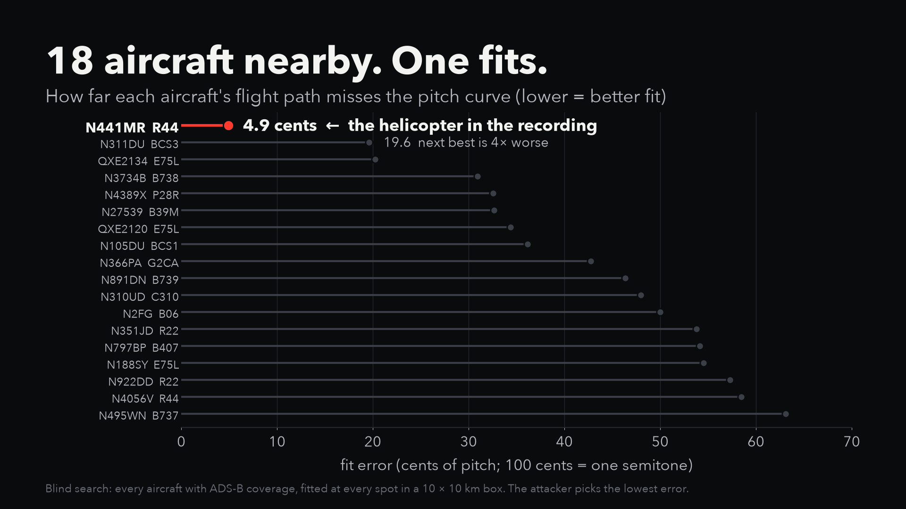
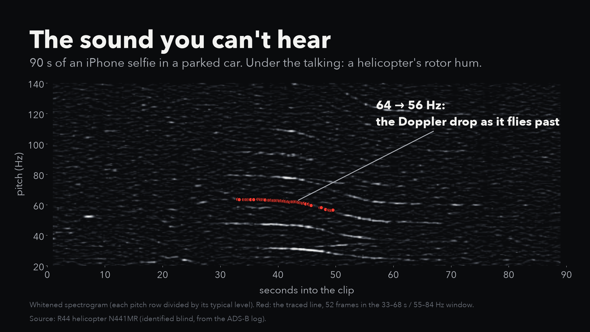
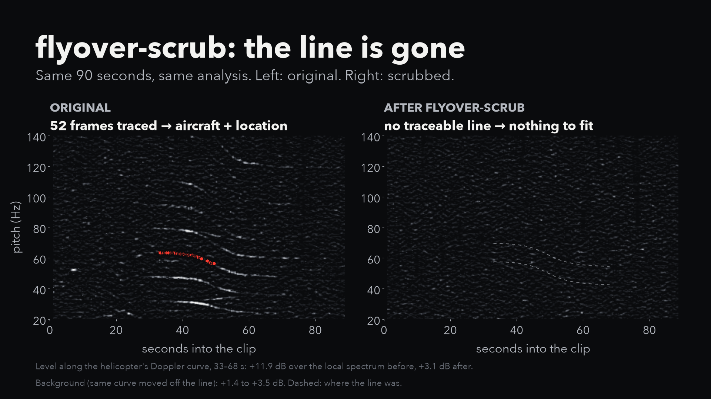
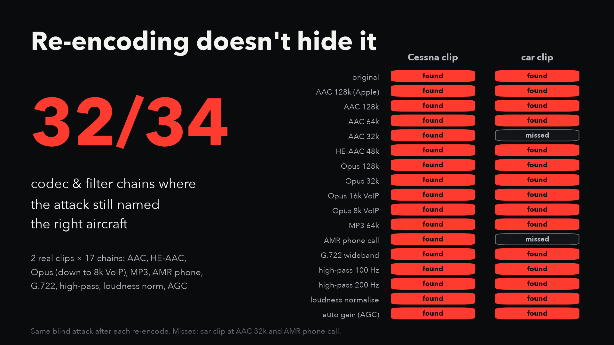
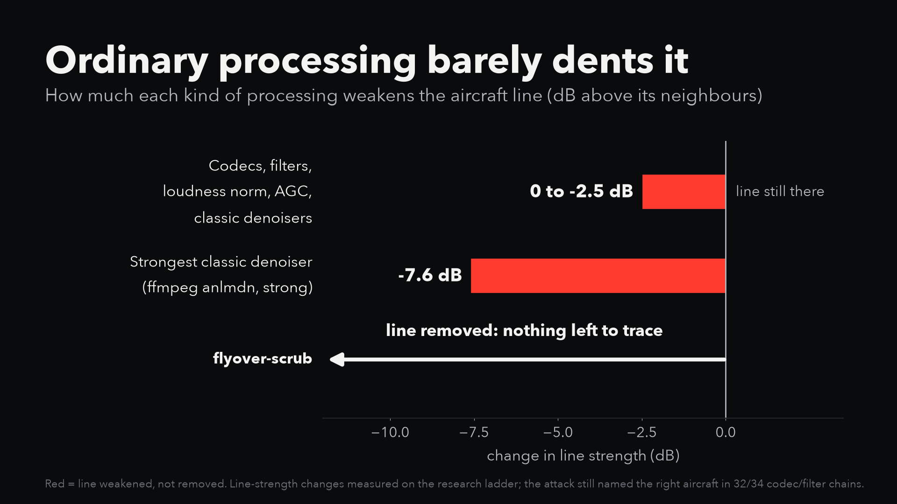
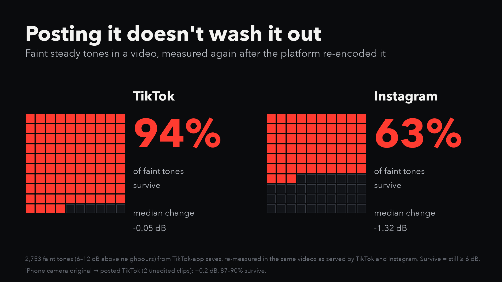

# Real-world replication: real iPhone videos, real ADS-B, real platforms

This builds on **colsto**'s video
[*I discovered a sound that leaks your exact location (and it's everywhere)*](https://www.youtube.com/watch?v=UytYrhYLOKI)
([youtube.com/@colsto](https://www.youtube.com/@colsto)). The attack and the trace-and-fit method are his. Everything
here is an independent replication on my own recordings, plus measurements of what codecs and social platforms do
to the evidence.

All recordings are mine (lizTheDeveloper), made on an iPhone between 2023 and 2024. Flight data is public ADS-B
from the [adsb.lol](https://adsb.lol) community archive.



## TL;DR

* **Grid hum can date a recording**, which the plane attack needs. One clip here carries it; `flyover-scrub`
  removes it (section 4).
* **The attack works on ordinary phone videos.** In a 90 s selfie video recorded in a parked car, a helicopter nobody noticed is
  enough to pick the right aircraft out of 18 and put the recording within ~800 m. In a 90 s indoor selfie, a
  Cessna 1 km away located the phone to **61–134 m**.
* **Re-encoding doesn't save you.** Through 17 codecs and filters (AAC, HE-AAC, Opus down to 8 kbps VoIP, MP3, the
  AMR phone codec, G.722, high-pass filters, loudness normalisation, AGC), the attack still picked the right aircraft
  in **32 of 34** runs. The line itself loses 0 to 2.5 dB; classic denoisers at most 7.6 dB, and it's still visible.
* **TikTok keeps it, Instagram mostly keeps it.** Faint steady tones survive TikTok's processing essentially
  untouched (~0 dB, ~94% still visible). Instagram costs ~1.3 dB and about a third of the faintest tones.
* **Only removing the line works.** After `flyover-scrub` there is no traceable line in either clip and the attack is
  at chance.

## 1. Two real proofs of concept

The attacker gets the audio and the recording's start time, and every aircraft within 20 km from the ADS-B archive.
They don't know which aircraft (if any) is audible. For each aircraft, the traced line is fitted at every point of a
10 × 10 km box. The best-fitting aircraft is the pick. The true location (the phone's GPS tag) is only used to score
the result.

| Clip | What's in it | Hidden aircraft | Aircraft tested | Picked | Error | After flyover-scrub |
|---|---|---|---|---|---|---|
| Car selfie (`helicopter-poc/`) | 90 s, talking in a parked car | R44 helicopter N441MR, closest 0.3 km | 18 with coverage | **right one** (fit 4.9 cents; next best 19.6) | 787 m | no traceable line |
| Cessna selfie | 90 s indoor talking, nothing audible | Cessna 172, closest ~1 km | 12 | **right one** | 61–134 m (true spot rank 1–9 of ~4,800) | no traceable line; audit 1.9 km, rank 471 |

The car clip's error is mostly along the helicopter's track. A clock error and an along-track shift produce
almost the same Doppler curve, and the fit chose a −6.75 s clock offset. With a second aircraft or a known clock it
would tighten.

**The Cessna clip is not published.** It was recorded at my former home, so its audio, date and flight logs would
give the address to anyone who reran this. Only its numbers are here.




**Neither clip's audio is published**: both are private conversations. `helicopter-poc/` has the flight logs
and ground truth for the car clip, and `run_poc.py` reproduces the result for anyone with the audio (or on your own recording):

```sh
uv run --with matplotlib python research/scripts/run_poc.py research/helicopter-poc --audio IMG_4367_cut.m4a --plot fit.png
uv run python research/scripts/run_poc.py research/helicopter-poc --audio IMG_4367_cut_scrubbed.m4a
```

### A counterexample: a loud band

A 2-minute video of a band playing (2024, Portland) had a Cessna 172 pass **200 m** away mid-song. No line is
visible under the music, and the audit ranks the true spot 1,545th of 1,593, no better than chance. Loud, broadband,
constantly changing music is the one thing in this study that hid a close light aircraft. It's not a defence you can
count on: the same audit found lines under talking, and a quieter song or a gap between songs would expose it.

### Why trace-fit and not the brightness scorer

The package's original scorer (`flyover_scrub.attack`) sums spectrogram energy under every modelled curve. It does
well on synthetic flyovers. On these real clips it was weak once its pitch was no longer tuned at the true spot (see
"Audit fixes" below). The method that works is the one colsto uses for faint curves, now in
`flyover_scrub.trace`:

1. Trace the visible line in a whitened 2 s-window spectrogram, following it frame by frame from its strongest point.
2. For each candidate spot, the flight track gives the Doppler factor g(t). The source pitch is solved in closed form
   (log f = log f0 + log g), and the score is the RMS residual in cents.
3. Lowest residual wins. As a chance check, the reversed line is fitted too: a real flyover only ever falls in pitch.
   On the car clip the reversed fit is 10× worse; for an unrelated aircraft it's 0.4×.

## 2. Codec and processing ladder



Each clip was encoded and decoded through each chain, then the blind attack was rerun
([`data/codec_ladder_attack.csv`](data/codec_ladder_attack.csv), [`scripts/ladder.sh`](scripts/ladder.sh)).

| Chain | Cessna clip | Car (helicopter) clip |
|---|---|---|
| Reference (lossless) | right aircraft, 134 m | right aircraft, 787 m |
| AAC 128k (Apple / ffmpeg), 64k | right, 61–417 m | right, 787 m |
| AAC 32k | right, 79 m | **wrong aircraft** |
| HE-AAC 48k (Instagram-like) | right, 379 m | right, 805 m |
| Opus 128k / 32k / 16k VoIP | right, 118–384 m | right, 783–787 m |
| Opus 8k VoIP | right, 450 m | right, 2.6 km |
| MP3 64k | right, 61 m | right, 787 m |
| AMR-NB 12.2k (phone call) | right, 368 m | **wrong aircraft** |
| G.722 (wideband call) | right, 107 m | right, 787 m |
| High-pass 100 Hz / 200 Hz | right, 414 m / 1.7 km | right, 787 m |
| Loudness normalisation (−14 LUFS), AGC | right, 61 m | right, 787 m |

Right aircraft in **32 of 34**. Several Cessna runs put the clock offset at the edge of the ±8 s search, which costs
location accuracy (400 m instead of 61 m). It doesn't cost aircraft identification.

**Line strength** (how far the plane line stands above its neighbours, raw STFT power;
[`data/line_strength.csv`](data/line_strength.csv), [`scripts/linesnr.py`](scripts/linesnr.py)):

| Processing | Change to the line |
|---|---|
| Every codec above, high-pass, loudness normalisation, AGC | 0 to −2.5 dB (worst: Opus 8k VoIP) |
| ffmpeg `afftdn` denoiser, 12–60 dB | 0 to −0.6 dB |
| ffmpeg `anlmdn` denoiser, default / strong | −4.0 / −7.6 dB, line still 7 dB above its neighbours |
| `flyover-scrub` | no traceable line |



Classic denoisers model *stationary* noise. A slowly gliding tone looks enough like signal that they leave it alone.

## 3. What platforms do to it

### What they serve

| Source | Audio served | ([`data/platform_codecs.csv`](data/platform_codecs.csv)) |
|---|---|---|
| TikTok (the video's own audio) | HE-AACv2, 44.1 kHz, 64 kbps | 476 posts |
| Instagram Reels | HE-AAC, 48 kHz, ~48–74 kbps | 12 reels |
| TikTok app's local save, before upload | AAC-LC, 44.1 kHz, ~125 kbps | 10 videos |

Gotcha for anyone measuring TikTok: yt-dlp's "audio" format is the post's reusable *sound*, not the video's audio
track. Use `-f "b[vcodec^=h264]"` and extract.

### What survives



The probes are the faint steady tones already in the recordings (fans, appliances, room hum): the same kind of
signal as a distant aircraft. Each was found in the copy before upload, then re-measured in the platform's copy of the same video
([`data/platform_probes_by_band.csv`](data/platform_probes_by_band.csv), raw:
[`data/platform_probes_raw.json`](data/platform_probes_raw.json), [`scripts/probes.py`](scripts/probes.py)).

| Path | Videos | Tones | Median change | Faint tones (6–12 dB) still visible |
|---|---|---|---|---|
| TikTok app save → TikTok | 10 | 4,359 | −0.05 dB | 94% |
| TikTok app save → Instagram | 10 | 4,359 | −1.3 dB (IQR −4.2 to +1.1) | 63% |
| iPhone camera original → TikTok | 2 | ~8,000 | −0.2 dB | 87–90% |

A third camera→TikTok pair lost more (−1.5 dB, 49%). It was cut into a longer, edited TikTok, so voice or music layered
on top probably masks it ([`data/camera_to_tiktok_pairs.csv`](data/camera_to_tiktok_pairs.csv)). Camera originals were
matched to posted TikToks blind, by sliding 8 s multi-band loudness envelopes ([`scripts/window_match.py`](scripts/window_match.py)).

Instagram's loss is more than its codec alone. HE-AAC on its own cost 0.3 dB in the ladder, so there's probably extra
processing. Two-thirds of faint tones still survive, so a plane line would usually still be findable.

### Limits of the platform data

* None of the matched camera→TikTok pairs had a strong aircraft inside the posted portion, so the platform evidence is
  about faint tones in general. The aircraft-specific evidence is the codec ladder.
* All 10 app-save videos are indoor talking-head clips. Any noise suppression TikTok or Instagram applies *while
  recording in-app* happened before the baseline and isn't measured. Testing it needs controlled round trips (record a
  synthetic flyover, post privately, download).
* Instagram: only the 12 most recent reels, because yt-dlp can't list older reels without a login.
* Not measured: YouTube, X, WhatsApp, Signal, iMessage, Discord, or the ML voice-isolation features on phones and in
  video calls.

### Some of the TikToks in the dataset

From when I lived in Portland, part of the 476-post set:

* [Backpropagation in neural networks](https://www.tiktok.com/@lizthedeveloper/video/7241740567917432106) (2023-06)
* [Don't be scared of neural networks](https://www.tiktok.com/@lizthedeveloper/video/7240936045427084586) (2023-06)
* [JSON and data structures](https://www.tiktok.com/@lizthedeveloper/video/7240906711870016811) (2023-06)
* [Networking for nerds](https://www.tiktok.com/@lizthedeveloper/video/7240228341071072558) (2023-06)

Recorded away from home, matched to their iPhone camera originals and measured above:

* [A 10-minute TikTok](https://www.tiktok.com/@lizthedeveloper/video/7244654039332326698) (2023-06, recorded while travelling): −0.2 dB, 90% of faint tones survive
* [A crossover episode](https://www.tiktok.com/@lizthedeveloper/video/7426376969249410346) (2024-10, recorded while travelling): edited, −1.5 dB, 49%

## 4. The other leak: grid hum (ENF)

Mains hum carries the **electrical network frequency**: the grid's 50 or 60 Hz wanders by a few hundredths of a
hertz, identically at every outlet on one interconnection. A recording that picks up the hum records that wander.
This is established forensics, not a new finding:

* **Dating a recording** by matching its hum against a logged reference: Grigoras,
  [*the ENF Criterion*](https://journal.equinoxpub.com/IJSLL/article/view/9977) (2005), and Cooper,
  [automated matching](https://aes2.org/publications/elibrary-page/?id=14411) (2008), used by the Metropolitan
  Police's forensic audio lab, which has logged UK mains frequency since about 2005
  ([coverage](https://gizmodo.com/police-can-timestamp-any-audio-recording-from-backgroun-5968396)).
  Short clips are the weak spot: [Huijbregtse & Geradts](https://doi.org/10.1007/978-3-642-03521-0_11) (2009)
  find matches get ambiguous under about 10 minutes, and [Hua et al.](https://arxiv.org/abs/2011.00176) (2020)
  find clip length is the main factor in reliability.
* **From video, with no audio at all.** Indoor lights flicker at twice the grid frequency, and a camera picks it
  up: Garg et al., [*"Seeing" ENF*](https://www.mast.umd.edu/files/paper_ENF/conf_paper1_ACMMM11.pdf) (2011/2013);
  Su et al. [use the rolling shutter](https://www.mast.umd.edu/files/paper_ENF/conf_paper11_ICIP14.pdf) (2014).
* **Location.** Telling *which grid* a clip came from, without any reference, is established
  ([Hajj-Ahmad, Garg & Wu, 2015](https://manuscript.isc.ac/Inventory/49/41600.htm)). Locating it *within* a grid
  has only been shown on clean power-line recordings
  ([Garg et al., 2013](https://www.mast.umd.edu/files/paper_ENF/conf_paper6_ICASSP13.pdf);
  [2021](https://arxiv.org/abs/2105.00668); [Yao et al., 2017](https://research.usq.edu.au/item/q7w37)).
  From phone audio it is still an open problem.
* **Removing it**: notch filtering and forging a fake hum, and detectors for both, in Chuang, Garg & Wu,
  [*How Secure are Power Network Signature Based Time Stamps?*](https://www.mast.umd.edu/files/paper_ENF/conf_paper2_ACMCCS12.pdf)
  (CCS 2012). Notching only the fundamental isn't enough: the higher harmonics carry it too
  ([Nicolalde-Rodríguez et al., 2013](https://www.eurasip.org/Proceedings/Eusipco/Eusipco2013/papers/1569728299.pdf)).

**Why it matters here:** the aircraft attack needs the recording time. Stripping the file's date doesn't protect
you if the hum can supply it, so ENF and the Doppler attack chain together: hum gives the time, the aircraft
gives the place.

**What we measured.** `flyover_scrub.enf` reports hum as ENF only when at least two harmonics of 50 or 60 Hz stand
out, imply the same grid frequency second by second, and sit within 0.2 Hz of nominal, so engines and fans don't
count. On the clips in this study:

| Clip | Grid hum? | After `flyover-scrub` |
|---|---|---|
| Outdoor clip (2023) | **Yes**: 120 Hz +23 dB and 240 Hz +16 dB above their neighbours, both implying a 59.998 Hz grid (wander 0.011 Hz), moving together | none detected (all harmonics back at the noise floor) |
| Car selfie (helicopter clip) | A 120 Hz tone, but it drifts around 60.1 Hz and its harmonics disagree: an engine or fan, correctly not reported | none detected |
| Cessna selfie, loud band | No hum above the floor | — |

**flyover-scrub already removes it.** Steady tones are re-synthesised as noise across the whole protected band
(20–2000 Hz by default), so every harmonic goes, not just 60 Hz. `--keep-hum` keeps them, and that reopens this
leak. TikTok passes steady faint tones through essentially untouched (section 3), so hum that's recorded is hum
that's published.

**Not covered:** flicker ENF in the *picture*. flyover-scrub only touches audio, so a video shot under mains
lighting can still be dated from its frames.

**Can a real clip be dated?** Not by us, yet. No public grid-frequency log for the US Western Interconnection
covers 2023: the [KIT database](https://power-grid-frequency.org/database/) has a Salt Lake City site for
2017–2020 only, and the [FNET/GridEye](https://fnetpublic.utk.edu/) history needs permission. The people best
placed to date recordings (grid operators, police labs) have the data; the public mostly doesn't.

## 5. Audit fixes that came out of this

* **The audit tuned the source pitch at the true location.** That handed the true spot a better score than every other
  candidate, even on scrubbed or time-reversed audio. It now sweeps pitch on a 3 × 3 grid spread over the search box
  and keeps the best, as an attacker would.
* **The verdict under-called a real flyover.** A real Cessna scored only 2–3× chance and was labelled "not located"
  while the true spot was ranked first. There's now a "possibly exposed" tier (true spot top 10 or top guess
  within 300 m, signal ≥ 2× chance).
* **`flyover-audit --trace T_LO,T_HI,F_LO,F_HI`** runs the trace-fit attack on a line you can see in the spectrogram,
  with the reversal check. On the car clip it reports "partly exposed" (806 m) where the brightness scorer saw nothing.

## Files

```
helicopter-poc/           ADS-B for every aircraft near the car clip, and its ground truth (audio withheld)
data/                     ladder, line-strength and platform measurements (CSV and JSON)
figures/                  plots; figures/video/ = 1920x1080 video graphics (scripts/make_video_figures.py)
scripts/run_poc.py        reproduce the car-clip proof of concept (needs the audio)
scripts/ladder.sh         codec/processing ladder (+ trace_attack_research.py, the script it calls)
scripts/linesnr.py        line strength through each chain
scripts/probes.py         TikTok app save vs TikTok vs Instagram tonal-probe survival
scripts/probes2.py        camera original vs posted TikTok
scripts/window_match.py   blind matching of posted copies to camera originals
scripts/screen_heatmaps.py  finds which of your own clips had a close aircraft pass (ranged reads of adsb.lol's daily archive)
```

The research scripts were run in a scratch directory and expect its layout (`aud/<clip>.wav` + `.meta`, flight-log
directories). `run_poc.py` runs on any recording plus its flight logs.

## Credits

* **colsto**, [*I discovered a sound that leaks your exact location (and it's everywhere)*](https://www.youtube.com/watch?v=UytYrhYLOKI):
  the attack, the emission-time Doppler model, and the trace-and-fit method used here.
* [adsb.lol](https://adsb.lol): open ADS-B data and its public history archive.
